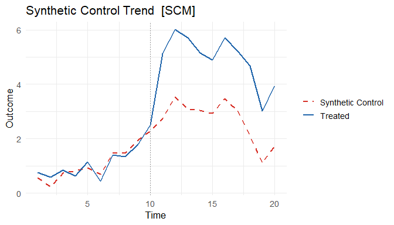
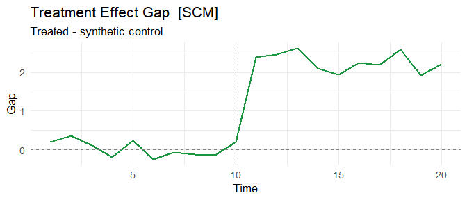
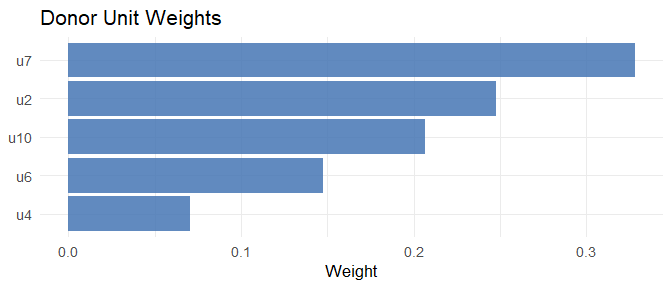
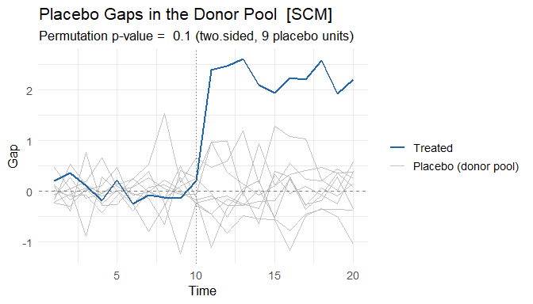
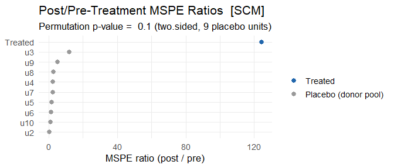

<!-- README.md is generated from README.Rmd. Please do not edit README.md directly. -->

# coresynth 

<!-- badges: start -->

[](https://CRAN.R-project.org/package=coresynth)
[](https://github.com/yo5uke/coresynth/actions/workflows/R-CMD-check.yaml)
[](https://opensource.org/licenses/MIT)
[](https://lifecycle.r-lib.org/articles/stages.html#experimental)
<!-- badges: end -->

**coresynth** is a high-performance R package that provides six causal
inference methods for panel data through a unified formula interface.
All core optimizations (QP solving, SVD, Kalman filtering) are
implemented in C++ via RcppArmadillo, so estimation stays fast even on
larger donor pools (see the [Performance](#performance) section for
timings).

## Installation

``` r
# From CRAN
install.packages("coresynth")

# Development version from GitHub
pak::pak("yo5uke/coresynth")
```

## Quick Start

coresynth fits causal panel models through a single formula interface,
`y ~ d | id + time`. This section walks through the classic Synthetic
Control Method (SCM); the same formula works for five other methods (see
[Supported Methods](#supported-methods)).

Your data should be a **balanced panel in long format** (one row per
unit × time), with:

- `y` — the outcome variable
- `d` — the treatment indicator: `0` normally, `1` for a treated unit in
  periods at or after its treatment starts
- `id` — the unit identifier
- `time` — the time identifier

``` r
library(coresynth)

# Generate a balanced panel (10 units, 20 periods, true ATT = 2.0)
set.seed(42)
N <- 10; TT <- 20; T_pre <- 10
f   <- cumsum(rnorm(TT, 0, 0.5))
lam <- rnorm(N, 1, 0.3)
dat <- expand.grid(time = seq_len(TT), id = paste0("u", seq_len(N)))
dat$y <- as.vector(outer(f, lam)) + rnorm(nrow(dat), 0, 0.3)
dat$d <- as.integer(dat$id == "u1" & dat$time > T_pre)   # u1 treated from t=11 on
dat$y[dat$d == 1] <- dat$y[dat$d == 1] + 2.0              # true ATT = 2

fit_scm <- scm_fit(y ~ d | id + time, data = dat, method = "scm")
summary(fit_scm)
#> === coresynth summary ===
#> Method : SCM 
#> Periods : T_pre = 10 | T_post = 10 
#> ATT estimate: 2.271136 
#> Unit weights (non-zero donors):
#>     u2     u4     u6     u7    u10 
#> 0.2474 0.0705 0.1476 0.3279 0.2066
```

The key arguments of `scm_fit()`:

- `formula` — `y ~ d | id + time`, matching the columns above
- `data` — the long-format panel
- `method` — the estimator to use (`"scm"`, `"sdid"`, `"gsc"`, `"mc"`,
  `"tasc"`, or `"si"`); all take the same formula

Many more arguments are available for covariate adjustment, donor
selection, and staggered adoption — see the [Covariates](#covariates)
and [Staggered Adoption](#staggered-adoption) sections below, or
`?scm_fit`.

``` r
# Observed vs. synthetic trend
plot(fit_scm, type = "trend")
```



``` r
# Treatment effect over time
plot(fit_scm, type = "gap")
```



``` r
# Donor unit weights
plot(fit_scm, type = "weights")
```



## Supported Methods

The same formula and data work for all six methods — just change
`method`:

``` r
methods <- c("scm", "sdid", "gsc", "mc", "tasc", "si")
fits    <- lapply(methods, \(m) scm_fit(y ~ d | id + time, data = dat, method = m))
names(fits) <- methods

# Compare ATT estimates (true value = 2.0)
data.frame(
  method   = methods,
  estimate = round(sapply(fits, `[[`, "estimate"), 3)
)
#>      method estimate
#> scm     scm    2.271
#> sdid   sdid    2.150
#> gsc     gsc    2.255
#> mc       mc    2.198
#> tasc   tasc    1.154
#> si       si    2.393
```

| Method | Full name | Reference | Treatment | Covariates | Inference |
|----|----|----|----|:--:|----|
| `scm` | Synthetic Control Method | Abadie, Diamond & Hainmueller (2010); staggered: Ben-Michael, Feller & Rothstein (2022) | Sharp & Staggered | `pred()` list | `mspe_ratio_pval()`, `scm_inference()`, `conformal_inference()` |
| `sdid` | Synthetic Difference-in-Differences | Arkhangelsky et al. (2021) | Sharp & Staggered | `covariates=` | `sdid_inference()`, `conformal_inference()` |
| `gsc` | Generalized Synthetic Control | Xu (2017) | Sharp & Staggered | `covariates=` time-varying | `gsc_boot()`, `gsc_inference()`, `conformal_inference()` |
| `mc` | Matrix Completion | Athey et al. (2021) | Sharp & Staggered | — | `conformal_inference()` |
| `tasc` | Time-Aware Synthetic Control | Rho et al. (2026) | Sharp & Staggered | — | — |
| `si` | Synthetic Interventions | Agarwal et al. (2025) | Sharp, Staggered & Multi-arm | — | `si_inference()`, `conformal_inference()` |

`conformal_inference()` (Chernozhukov, Wüthrich & Zhu 2021) provides
permutation-based p-values and confidence intervals for **sharp** fits
across `scm`/`sdid`/`gsc`/`mc`/`si`.

## Staggered Adoption

All six methods support staggered adoption, and all aggregate the cohort
ATTs the same way (Clarke et al. 2024): with weights proportional to
`N_treated × T_post`. How each cohort ATT is obtained differs by
estimator family. `scm`, `sdid`, `gsc`, and `si` fit every adoption
cohort separately. `mc` and `tasc` impute the counterfactual instead,
from a single fit whose observation mask already blanks each treated
unit from its own adoption date, so no cohort-by-cohort refitting is
needed; their cohorts share one donor set and they take no
`control_group` argument.

``` r
# u1: treated from t=11, u2: treated from t=16
dat_s        <- dat
dat_s$d      <- 0L
dat_s$d[dat_s$id == "u1" & dat_s$time > 10] <- 1L
dat_s$d[dat_s$id == "u2" & dat_s$time > 15] <- 1L
# u1 already carries the +2 from `dat`; give u2 the same effect
dat_s$y[dat_s$id == "u2" & dat_s$d == 1] <-
  dat_s$y[dat_s$id == "u2" & dat_s$d == 1] + 2.0

# All methods detect staggered timing automatically
fit_sdid <- scm_fit(y ~ d | id + time, data = dat_s, method = "sdid")
fit_gsc  <- scm_fit(y ~ d | id + time, data = dat_s, method = "gsc")
fit_mc   <- scm_fit(y ~ d | id + time, data = dat_s, method = "mc")
fit_si   <- scm_fit(y ~ d | id + time, data = dat_s, method = "si")

# Cohort-level estimates are accessible
fit_sdid$cohort_estimates
#>   cohort n_treated T_pre T_post estimate weight
#> 1     11         1    10     10     2.11  0.667
#> 2     16         1    15      5     2.16  0.333

# Donors are the never-treated units: a unit that adopts later would be
# treated itself during the earlier cohort's post-treatment window
```

### SCM: Partially Pooled Synthetic Controls

The original SCM targets a single treated unit, so its staggered
extension deserves a note. coresynth follows Ben-Michael, Feller &
Rothstein (2022): units adopting at the same time are averaged into one
cohort (fully pooling within a cohort is justified by their theory,
since the data-generating process cannot vary across units sharing one
adoption time), and the cohort weight vectors are then chosen jointly
rather than one at a time.

``` r
# Defaults: nu = "auto" (the paper's heuristic) and fixedeff = TRUE (an
# intercept shift, which demeans each unit by its own pre-treatment mean).
fit_pp <- scm_fit(y ~ d | id + time, data = dat_s, method = "scm")
fit_pp$pooling   # balance diagnostics: q_sep / q_pool vs. separate SCM

# nu in [0, 1] sets the pooling directly: 0 trades everything for per-cohort
# fit, 1 for the fit of the *average* placebo gap across cohorts, which
# anchors the aggregate ATT. The paper advises against both extremes.
# nu = "separate" is the per-cohort path, which keeps the V optimisation,
# donor filtering and penalty options the pooled solver has no room for.
scm_balance_frontier(fit_pp)   # the nu trade-off across a grid

# Leave-one-unit-out jackknife (BFR Appendix A.1): donors are resampled too
scm_inference(fit_pp)
```

`pool_cohorts = FALSE` gives each treated unit its own weight vector
instead (the paper’s Section 4 formulation), which is what
`scm_rank_pval()` needs. `weights` sets the mass each treated unit
carries in the aggregate ATT – a population or GDP figure, following
Abadie (2021, S.8).

## Covariates

### SCM: Predictor Variables via `pred()`

SCM supports covariate-based matching following Abadie et al. (2010)
S.2.3. Use `pred(vars, times, op)` to specify which variables and time
windows to include in the predictor matrix:

``` r
# Assume dat has extra columns: income, unemp
fit_scm_cov <- scm_fit(
  y ~ d | id + time,
  data   = dat,
  method = "scm",
  predictors = list(
    pred(c("income", "unemp"), 1:8),   # average income & unemp over pre-period
    pred("y", 5),                       # outcome at a specific pre-treatment year
    pred("y", 1:4, op = "mean")         # outcome averaged over early pre-period
  )
)
summary(fit_scm_cov)   # shows predictor balance table
```

Each `pred()` call aggregates one or more variables over a time window
using `op = "mean"` (default), `"median"`, or `"sum"`. Multiple `pred()`
calls with different windows can be combined freely in the list.

### GSC: Time-Varying Covariates

GSC supports time-varying covariate adjustment via the full EM algorithm
of Xu (2017). Pass a character vector of column names as `covariates`:

``` r
# Assume dat has a time-varying column: gdp_growth
fit_gsc_cov <- scm_fit(
  y ~ d | id + time,
  data       = dat,
  method     = "gsc",
  r          = 2,
  covariates = "gdp_growth"
)
fit_gsc_cov$beta   # estimated beta coefficient(s)
```

The EM loop alternates between:

- **E-step**: SVD of $\tilde{Y}_{it} = Y_{it} - x_{it}'\hat\beta$ to
  update factors $\hat{F}$, $\hat\Lambda$
- **M-step**: Ridge OLS of residuals on $x_{it}$ to update $\hat\beta$

Treated unit loadings are estimated from covariate-demeaned
pre-treatment data per Xu (2017) Step 2. When `covariates = NULL`
(default), the plain 3-step SVD estimator ($\hat\beta = 0$) is used.

## Inference

### SCM: In-Space Placebo Test

`mspe_ratio_pval()` runs the in-space placebo study of Abadie, Diamond &
Hainmueller (2010): the intervention is reassigned to each donor unit
and the treated unit’s post/pre-treatment MSPE ratio is compared against
the placebo distribution. The result can be plotted directly.

``` r
scm_p <- mspe_ratio_pval(fits$scm)
scm_p$p_value
#> [1] 0.1

# Treated gap vs. placebo gaps in the donor pool (ADH 2010, Figures 4-7)
plot(scm_p, type = "gaps")
```



Placebo units with a poor pre-treatment fit can be pruned with
`mspe_prune` (e.g. `plot(scm_p, type = "gaps", mspe_prune = 5)` excludes
units whose pre-treatment MSPE exceeds 5 times the treated unit’s).

``` r
# Post/pre-treatment MSPE ratio of every unit (ADH 2010, Figure 8)
plot(scm_p, type = "ratios")
```



### Other Inference Methods

``` r
# SDID: four inference methods — placebo, bootstrap, jackknife, jackknife_global
sdid_inf <- sdid_inference(fits$sdid, method = "placebo")
tidy(sdid_inf)   # broom-style one-row data.frame

sdid_boot <- sdid_inference(fits$sdid, method = "bootstrap", n_boot = 200, seed = 1)
tidy(sdid_boot)

# GSC: parametric bootstrap under H0 (sharp only)
gsc_ci <- gsc_boot(fits$gsc, B = 200, alpha = 0.05)
cat("95% CI: [", gsc_ci$ci_lower, ",", gsc_ci$ci_upper, "]\n")

# GSC / SI: non-parametric inference (sharp + staggered)
gsc_inf <- gsc_inference(fits$gsc, method = "jackknife")
si_inf  <- si_inference(fits$si,  method = "bootstrap", n_boot = 200, seed = 1)
tidy(gsc_inf)
tidy(si_inf)

# Conformal inference (Chernozhukov, Wüthrich & Zhu 2021) — sharp fits for
# scm / sdid / gsc / mc / si. Re-estimates the counterfactual under the null
# and inverts a moving-block permutation test for a p-value and CI.
conf <- conformal_inference(fits$scm, tau0 = 0, level = 0.95)
tidy(conf)
```

## tidyverse / broom Integration

``` r
library(broom)

# Extract weights as a data frame
tidy(fits$scm)

# Summary row
glance(fits$scm)

# JSON export (for reproducibility and AI workflows)
export_json(fits$scm, file = "scm_result.json")
```

Every `plot()` view also has a matching data extractor. `plot_data()`
returns the tidy data frame that a figure is drawn from — taking the
same `type` argument as `plot()` — so you can rename the simplified
series labels, drop the numbers into a table, or build a bespoke figure
with your own code. `plot()` stays the quick path; `plot_data()` is the
handle when you want the data itself. For example, the `"trend"` view:

``` r
head(plot_data(fits$scm, type = "trend"))
#>   time     value  series
#> 1    1 0.7590559 Treated
#> 2    2 0.5774968 Treated
#> 3    3 0.8414384 Treated
#> 4    4 0.6355518 Treated
#> 5    5 1.1532557 Treated
#> 6    6 0.4384856 Treated
```

## Performance

On a 100-donor, 10-year monthly panel, a full SCM fit and its in-space
placebo test across all 100 donors both complete in well under a second;
Synth takes over a minute for the fit alone, and about an hour and a
half for the placebo test, on the same data and predictor specification
(outcomes-only, matching solutions). Measured against Synth 1.1.10 on
Windows 11 / R 4.6.1.

| Panel | Synth fit | coresynth fit | Synth placebo (all donors) | coresynth placebo (all donors) |
|----|---:|---:|---:|---:|
| 40 donors, 2 yr pre / 5 mo post | 5.8 s | 3 ms | 3.5 min | 12 ms |
| 100 donors, 8 yr pre / 2 yr post (monthly) | 70 s | 20 ms | ~97 min | 0.4 s |

## References

- Abadie, A., Diamond, A., & Hainmueller, J. (2010). Synthetic control
  methods for comparative case studies. *JASA*, 105(490), 493–505.
- Abadie, A., & Zhao, J. (2026). Synthetic controls for experimental
  design. *Review of Economics and Statistics*.
  <doi:10.1162/REST.a.1837>
- Agarwal, A., Shah, D., & Shen, D. (2025). Synthetic interventions:
  extending synthetic controls to multiple treatments. *Operations
  Research*. <doi:10.1287/opre.2025.1590>
- Arkhangelsky, D., Athey, S., Hirshberg, D. A., Imbens, G. W., &
  Wager, S. (2021). Synthetic difference-in-differences. *AER*, 111(12),
  4088–4118.
- Athey, S., Bayati, M., Doudchenko, N., Imbens, G., & Khosravi, K.
  (2021). Matrix completion methods for causal panel data models.
  *JASA*, 116(536), 1716–1730.
- Ben-Michael, E., Feller, A., & Rothstein, J. (2021). The augmented
  synthetic control method. *JASA*, 116(536), 1789–1803.
- Ben-Michael, E., Feller, A., & Rothstein, J. (2022). Synthetic
  controls with staggered adoption. *JRSS-B*, 84(2), 351–381.
- Chernozhukov, V., Wüthrich, K., & Zhu, Y. (2021). An exact and robust
  conformal inference method for counterfactual and synthetic controls.
  *JASA*, 116(536), 1849–1864.
- Clarke, D., Pailañir, D., Athey, S., & Imbens, G. (2024). On synthetic
  difference-in-differences and related estimation methods in Stata.
  *The Stata Journal*, 24(4). <doi:10.1177/1536867X241297914>
- Rho, S., Illick, C., Narasipura, S., Abadie, A., Hsu, D., & Misra, V.
  (2026). Time-aware synthetic control. *AISTATS 2026* (poster).
  arXiv:2601.03099
- Xu, Y. (2017). Generalized synthetic control method. *Political
  Analysis*, 25(1), 57–76.
